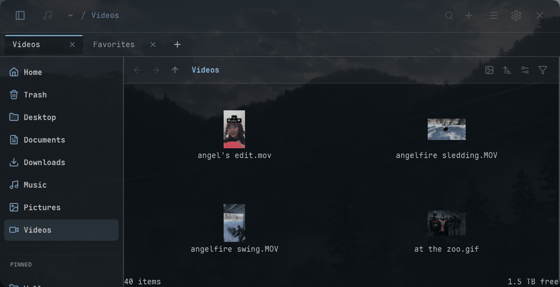
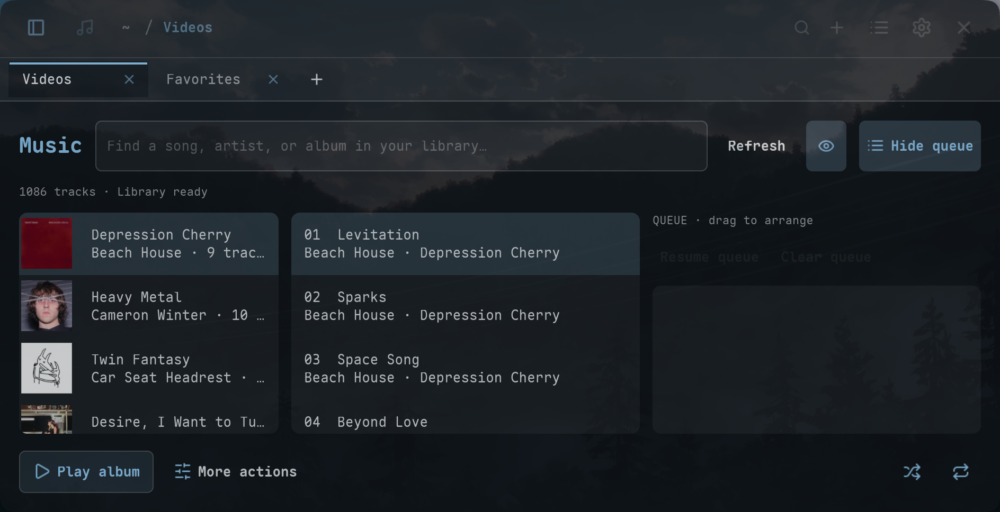
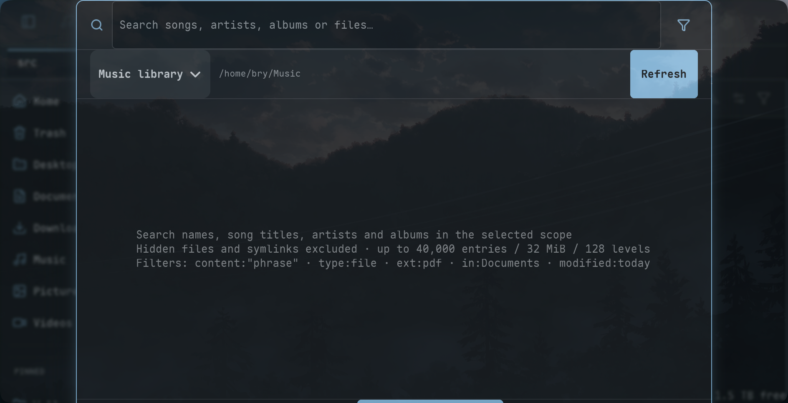

# Hermes

**An ultra-fast, keyboard-first file manager, media workspace, and music player for Linux.**

[](LICENSE)
[](https://www.rust-lang.org/)
[](https://gtk.org/)

Hermes is an experimental, keyboard-centric file manager and media hub engineered for Wayland and modern Linux desktops (designed primarily for Omarchy). It pairs Miller-column navigation with an integrated background music player, optional waveform visualization, bounded media/document previews, and retained tab views.

> [!NOTE]
> **Origins & Attribution**: Hermes is derived from **[Strata](https://github.com/LGSE/strata)**, originally conceived and built by **Pierre Bérubé** and the **[LGSE](https://github.com/LGSE)** team. Hermes builds upon Strata’s architectural foundation—its GTK4/Rust design, cancellable directory enumeration, and Bubblewrap sandboxing—expanding it into a full-featured daily-driver file and music experience with retained tabs, whole-library music indexing, MPRIS v2 desktop integration, and high-performance image/video pipelines.

<p align="center">
  
</p>

---

## Browser Modes

### List (Miller Columns)
Navigate deep folder hierarchies with keyboard arrows or mouse, featuring instant, cancellable folder peeking on hover.


### Explorer
Detailed, sortable table view for auditing file metadata, permissions, dates, and sizes.


### Grid
Responsive icon tiles with high-performance thumbnail caching.


---

## Key Features

### ⚡ Navigation & Retained Native Tabs
- **Miller-Column Navigation**: Fluid horizontal column reveal with stable layouts and hover peeking.
- **Retained Tabs Engine**: Inactive tabs remain cached in memory by `TrailId` within a bounded budget (~64 MiB). Switching tabs is instant—no row reconstruction, layout churn, or lost scroll/selection state.
- **Virtualized Lists**: Handles folders with 100,000+ entries effortlessly using GTK4 list models.
- **Cancellable Off-Thread I/O**: Directory navigation streams bounded batches (first 32 entries visible immediately); rapid navigation cancels stale generation requests instantly.
- **Safe, Atomic Operations**: File copies use private staging beside the target destination before publication; same-filesystem moves use atomic rename. An existing file is never deleted prior to a verified transfer.

### 🎵 Integrated Music Player & Library
- **Dedicated Music View (<kbd>Ctrl</kbd>+<kbd>M</kbd>)**: Albums, Artists, Songs, Favorites and Playlists, with disc-then-track metadata ordering within albums.
- **Favorites & Playlist Editor**: Use song hearts or track/album menus; a separate editor manages playlist names, membership and drag/keyboard ordering without changing audio files. Most played and Recently added collections update locally; missing paths remain saved and are skipped for playback.
- **Live Playback Queue**:
  - Reorder queued tracks (<kbd>Alt</kbd>+<kbd>Up</kbd> / <kbd>Down</kbd> or drag handle).
  - Context menu actions on tracks and albums: **Play**, **Play next**, and **Add to queue** (<kbd>Shift</kbd>+<kbd>F10</kbd> or right-click).
  - Queue additions never interrupt currently playing tracks.
  - Automatically checkpointed to `$XDG_STATE_HOME/strata/music-queue-v1.json`—restarts restore your queue without annoying autoplay.
- **Persistent Bottom Transport Bar**: Always accessible during playback, featuring album art, draggable scrub timeline, volume slider, shuffle, and repeat.
- **Live Audio Waveforms**: Real-time waveform visualization in the Music view with a one-click visibility toggle.
- **Desktop MPRIS v2 Bridge**: Exposes `org.mpris.MediaPlayer2.hermes` for native desktop widgets, lock screens, and hardware media keys (play/pause, skip, seek, volume, and cover art).
- **Whole-Library Music Search (<kbd>Ctrl</kbd>+<kbd>Shift</kbd>+<kbd>K</kbd>)**: Instantly search song titles, artists, and albums across your entire music collection with live background metadata indexing.



### 🛡️ Sandboxed Media & Document Previews
Image/document renderers use a **[Bubblewrap (`bwrap`) sandbox](docs/preview-sandbox.md)** with tight CPU, memory, and output boundaries. Native GStreamer decoding uses its own isolated worker; audio output remains in the host:
- **Progressive Photo Loading**: Show an existing, source-validated thumbnail while the full preview loads, using the same viewport layout and opaque image background to avoid ghosting. Bounded native JPEG/HEIF paths speed up eligible selected photos; large or unsupported encodings retain the existing fallback. AVIF, SVG and JPE/JFIF thumbnails are supported.
- **Persistent Thumbnails**: A private, bounded background disk cache retains small thumbnails across restarts, validating both file and album-cover identities. Full selected previews still decode the original; cached thumbnails never replace full quality.
- **Visible-First Thumbnail Work**: Visible items load before nearby prefetch; hidden tabs defer their own work. Matching requests share an identity-checked render, with bounded background admission and independent cancellation for each view.
- **Large Photo Loading**: Eligible large JPEG and standard 8-bit HEIF previews can use the optional installed `vips` tool inside the sandbox, with the existing ImageMagick fallback. Original orientation and the 1400px preview bounding box remain; HDR/wide-gamut HEIF keeps its existing renderer.
- **Streaming Video Previews**: Persistent isolated GStreamer decoder with draggable scrub handles, cached-poster reuse and a 200 ms poster fallback on misses. Background initialization begins after the window appears, without autoplay; the first registry scan still has a cost. Playback is full length; press <kbd>F</kbd> for fullscreen.
- **Camera RAW Support**: Decodes DNG, CR2/CR3, NEF, ARW, RAF, ORF, RW2, and more via host LibRaw or ImageMagick.
- **Fullscreen PDF Reader**: Read multi-page PDFs with reading-position retention, zoom controls, and fullscreen toggle (<kbd>F</kbd>).
- **Animated GIF Previews**: Sandboxed loopable playback with VP8 alpha-transparency retention.
- **Photo Preview Menus**: Right-click an image in the drawer or fullscreen for file actions and Fullscreen/Fit/100% controls.
- **Rich Text & Syntax Highlighting**: View source code and formatted text via GtkSourceView 5 with selectable mono fonts.
- **Format & Speed Audit**: See the [preview audit](docs/preview-format-audit.md) for verified coverage, Dolphin/Strata comparisons, measurements and remaining cold-loading work.

### 🔍 Search & Custom Actions
- **Fuzzy Search (<kbd>Ctrl</kbd>+<kbd>K</kbd>)**: Search Home by default, the current folder (including another drive), or your music library with live results and file-type badges. Exact music filters such as `artist:"Beach House"`, `album:"Depression Cherry"`, and `title:"Space Song"` compose with type, extension, dates, and optional content filters. Result tabs retain relevance order until you choose a sort and keep incomplete-search notices visible alongside matches.
- **Built-in Smart Matching**: Try `Beach House songs`, `songs by Cameron Winter`, `PDFs in Downloads`, or `videos from last week`. Inferred filters keep direct filename/tag matches such as `Video Games` available and ranked first; explicit filters remain strict. Quotes protect literal phrases, including when applying or clearing filters. Dismiss an inferred chip to search its words literally.
- **Persistent Search Catalog**: General search keeps a private SQLite snapshot of filenames, identities and available song tags across restarts, revalidates saved sources and reconciles file changes in the background. Concurrent searches share live catalogs; complete parent catalogs serve folder searches, and Home reuses Music's existing tag catalog. Index coverage remains bounded and partial coverage is shown.
- **Saved Searches & Smart Folders (Optional)**: Hidden by default in favor of built-in smart matching. When enabled, **Save search** keeps a named query in the sidebar; **Manage searches…** edits its name, query, scope and result group, with confirmation before deleting a saved definition. Files stay in place; query definitions are stored separately from disposable search caches. See [saved searches](docs/saved-searches.md).
- **Grouped Unified Search**: Switch between All, Files, Songs, Albums and Artists. Album/artist rows use song tags and artwork, show matching-song counts, and open their scoped songs inside search with Back navigation. File-type filters remain independent. Song-result tabs preserve artist/album context without inventing filesystem folders; untagged audio remains searchable as songs.
- **Paged Search Results**: Load another 100 ranked matches with More without changing the search panel's size. Result tabs show every match in the bounded index. Exact type, extension and music-field filters use a lazy, disposable SQLite index; fuzzy ranking and opt-in content checks retain their existing semantics. File changes invalidate old page requests rather than mixing snapshots.
- **Stable Search Layout**: Suggested filters, counts and indexing notices share one compact status line. Long names and paths truncate with full details in tooltips instead of pushing the panel wider; status and suggestion updates keep the results and footer in place.
- **Content Search**: Opt-in, off-thread search inside documents (PDF, DOCX, ODT) and text files up to 1 MiB.
- **Custom Context Actions**: Define custom, argument-based actions in `~/.config/hermes/actions.toml` without shell injection risks (see [Custom Actions](docs/custom-actions.md)).
- **Clipboard & Context Menus**: Standard file Copy/Cut/Paste and Copy location, compact click-to-expand clipboard feedback, and optional actions under Settings → Context menu. Native folder Copy interoperability is checked with Dolphin on X11 and Wayland.



### 🎨 Theming & Modern Linux Integration
- **Theming**: Native Wayland and X11 support, Noctalia theme styling, and Omarchy Quattro / Omarchy 3 integration.
- **Square Tabs & Density**: Square tab surfaces with configurable airy and compact density modes.
- **Selectable Fonts**: Built-in support for Maple Mono and JetBrains Mono fonts.

---

## Keyboard Shortcuts

| Shortcut | Action |
| :--- | :--- |
| <kbd>Left</kbd> / <kbd>Right</kbd> | Navigate parent / child column |
| <kbd>Up</kbd> / <kbd>Down</kbd> | Move selection up / down |
| <kbd>Space</kbd> | Toggle preview drawer |
| <kbd>Ctrl</kbd> + <kbd>T</kbd> | Open new tab |
| <kbd>Ctrl</kbd> + <kbd>W</kbd> | Close current tab |
| <kbd>Ctrl</kbd> + <kbd>1</kbd> / <kbd>2</kbd> / <kbd>3</kbd> | Switch view mode: List / Explorer / Grid |
| <kbd>Ctrl</kbd> + <kbd>M</kbd> | Open Music view |
| <kbd>Ctrl</kbd> + <kbd>K</kbd> | Search current scope |
| <kbd>Ctrl</kbd> + <kbd>Shift</kbd> + <kbd>K</kbd> | Search whole Music library |
| <kbd>F</kbd> | Fullscreen active video, image, or PDF preview |
| <kbd>Shift</kbd> + <kbd>F10</kbd> / <kbd>Menu</kbd> | Open context menu for selected item |
| <kbd>Alt</kbd> + <kbd>Up</kbd> / <kbd>Down</kbd> | Reorder selected track in playback queue |
| <kbd>Ctrl</kbd> + <kbd>H</kbd> | Toggle hidden files |
| <kbd>Ctrl</kbd> + <kbd>R</kbd> | Refresh current folder / library |

---

## Installation

### Prerequisites (Arch Linux / Omarchy)

Install the required system libraries, GTK4 runtime, GStreamer plugins, and preview tools:

```bash
sudo pacman -S --needed \
    bubblewrap \
    ffmpeg \
    ffmpegthumbnailer \
    fontconfig \
    gst-plugins-base \
    gst-plugins-good \
    gst-plugins-bad \
    gst-libav \
    gtk4 \
    gtksourceview5 \
    gvfs \
    libarchive \
    libheif \
    poppler-glib \
    imagemagick \
    libraw
```

Optional large-photo acceleration uses `libvips` (`sudo pacman -S --needed libvips`).
It is already available on the tested host; Hermes still works without it and no installer runs automatically.

### Build from Source

Ensure you have a modern Rust toolchain installed (edition 2024 / Rust 1.85+):

```bash
# Clone the repository
git clone https://github.com/battlemountain2/hermes.git
cd hermes

# Build release binary
cargo build --release

# Install to ~/.local/bin
install -Dm755 target/release/strata ~/.local/bin/hermes
```

*(Note: The internal binary identifier remains `strata` during active migration; copying it as `hermes` provides standard execution.)*

### Development Mode

Development mode opens Hermes once and rebuilds in the background when files change. Your open
window and playback stay in place; reopen Hermes when you want to use a new build. Background
builds use two jobs at lower CPU priority and idle disk priority when `ionice` is available:

```bash
make start-dev
```

To run development mode against release-optimized builds:

```bash
HERMES_DEV_RELEASE=1 make start-dev
```

Automatic restarting is available explicitly:

```bash
HERMES_DEV_AUTO_RESTART=1 make start-dev
```

Run test suites and quality linters:

```bash
./scripts/check.sh
```

---

## Desktop Integration

### Desktop Entry

Create a user desktop entry so your application launcher and `xdg-open` recognize Hermes:

```bash
mkdir -p ~/.local/share/applications
cat > ~/.local/share/applications/hermes.desktop <<EOF
[Desktop Entry]
Name=Hermes
Comment=Ultra-fast keyboard-first file manager and media workspace
Exec=$HOME/.local/bin/hermes %U
Icon=system-file-manager
Terminal=false
Type=Application
Categories=Utility;FileManager;AudioVideo;
MimeType=inode/directory;
StartupNotify=true
EOF

update-desktop-database ~/.local/share/applications
xdg-mime default hermes.desktop inode/directory
```

### Omarchy / Hyprland Shortcut

To set Hermes as your primary file manager shortcut (<kbd>Super</kbd>+<kbd>Shift</kbd>+<kbd>F</kbd>):

#### Omarchy Quattro (`~/.config/hypr/bindings.lua`)
```lua
hl.unbind("SUPER + SHIFT + F")
hl.unbind("SUPER + ALT + SHIFT + F")
o.bind("SUPER + SHIFT + F", "File manager", "uwsm app -- hermes")
o.bind("SUPER + ALT + SHIFT + F", "File manager (cwd)",
  "uwsm app -- hermes \"$(omarchy-cmd-terminal-cwd)\"")
```

#### Omarchy 3 / Hyprland (`~/.config/hypr/bindings.conf`)
```ini
bindd = SUPER SHIFT, F, File manager, exec, uwsm app -- hermes
bindd = SUPER SHIFT ALT, F, File manager (cwd), exec, uwsm app -- hermes "$(omarchy-cmd-terminal-cwd)"
```

Reload Hyprland:
```bash
hyprctl reload
```

---

## Architecture & Principles

- **Small Application Core**: Filesystem logic, navigation trails, and persistence are decoupled from GTK widgets.
- **Strict Memory Safety**: Unsafe code is strictly audited and denied by default (`unsafe_code = "deny"`).
- **Bubblewrap Sandbox Isolation**: Untrusted metadata, document, image, and media decoders execute in ephemeral Bubblewrap sandboxes with memory limits and no network access.
- **Atomic File Transactions**: Staged publication prevents data loss during file copies and moves.
- **Off-Thread Metadata Engine**: Tags, thumbnails, and waveforms load asynchronously without stuttering the GTK main thread.

Refer to [`docs/architecture.md`](docs/architecture.md), [`docs/hermes-direction.md`](docs/hermes-direction.md), and [`docs/performance-baseline.md`](docs/performance-baseline.md) for detailed architectural blueprints and performance benchmarks.

---

## Credits & Acknowledgements

Hermes is built upon open-source foundations and would not exist without the following projects:

- **[Strata](https://github.com/LGSE/strata)**: Original project created by **Pierre Bérubé** and the **[LGSE](https://github.com/LGSE)** team. We are deeply grateful for their innovative vision, Miller-column design, and rock-solid Rust/GTK4 architectural base.
- **[Lucide Icons](https://github.com/lucide-icons/lucide)**: Clean symbolic icons (ISC License).
- **[JetBrains Mono](https://github.com/JetBrains/JetBrainsMono)** & **[Maple Mono](https://github.com/subframe7536/maple-font)**: Typographic font assets (SIL Open Font License 1.1).
- The **GTK-rs**, **GStreamer**, and **Rust** communities for first-class desktop Linux developer tooling.

Detailed third-party license notices are available in [`THIRD_PARTY_LICENSES.md`](THIRD_PARTY_LICENSES.md).

---

## License

Hermes is free and open-source software licensed under the **[GNU General Public License v3.0 or later](LICENSE)** (GPL-3.0-or-later), continuing the copyleft heritage of Strata.
